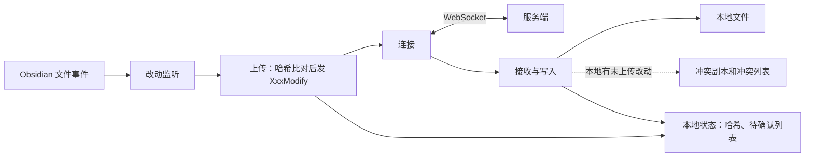

# Fast Note Sync 插件：新人导览

> **30 秒版**：这是 Fast Note Sync 的 Obsidian 插件，是[整套系统](../../../fast-note-sync-service/docs/atlas/README.md)里装在每台设备上的那一端。它监听笔记库里的文件变化，通过 WebSocket 发给服务端；服务端推下来的别处的改动，它写进本地文件。电脑、手机上的 Obsidian 都用它。同步协议、冲突怎么判断、离线同步策略的含义，在服务端的[同步](../../../fast-note-sync-service/docs/atlas/sync.md)一节讲，这里只讲插件这一端怎么做。

## 组成

| 部分 | 一句话 | 什么时候读 | 文档 |
|---|---|---|---|
| 连接 | 和服务端的 WebSocket 连接：认证、断线重连、切回 Obsidian 时重连 | 排查连不上、反复重连 | [websocket_manager.ts](../../src/lib/sync/websocket_manager.ts)、[websocket_client.ts](../../src/lib/sync/websocket_client.ts) |
| 全量同步 | 连上后对笔记、文件夹、配置、附件各做一轮比对，大清单分批发送 | 改同步流程、排查"重连后没补齐" | [operator.ts](../../src/lib/sync/operator.ts) 的 `handleSync` |
| 改动监听与上传 | 监听 Obsidian 的文件事件，稍等片刻再处理，用哈希判断是否真的变了，然后上传 | 改上传时机、排查"改了没传上去" | [events_manager.ts](../../src/lib/utils/events_manager.ts)、[operator_note.ts](../../src/lib/sync/operator_note.ts) |
| 接收与写入 | 收到推送后写进本地文件；本地有没上传的改动时不覆盖，另存一份并标成冲突 | 改写盘逻辑、冲突处理 | [operator_note.ts](../../src/lib/sync/operator_note.ts) 的 `receiveNoteSyncModify`、[views/](../../src/views/) 里的冲突弹窗 |
| 附件 | 附件的上传下载，大附件分片传输 | 改附件同步、大文件问题 | [operator_file.ts](../../src/lib/sync/operator_file.ts) |
| 配置同步 | Obsidian 配置文件（`.obsidian` 下的文件）的同步 | 改配置同步 | [operator_config.ts](../../src/lib/sync/operator_config.ts)、[config_manager.ts](../../src/lib/sync/config_manager.ts) |
| 本地状态 | 哈希缓存、待确认的上传、冲突列表，持久化在本地 | 排查状态错乱 | [src/lib/storage/](../../src/lib/storage/)、[sync_state.ts](../../src/lib/sync/sync_state.ts) |
| 设置与界面 | 设置页、同步日志、历史版本、回收站、分享、冲突列表 | 改界面 | [setting.tsx](../../src/setting.tsx)、[src/views/](../../src/views/) |

## 怎么配合

一次改动在插件里走两段，整条链路见服务端根节点的[走查](../../../fast-note-sync-service/docs/atlas/README.md#走一遍手机上改一篇笔记电脑上收到)。

**上传。** 文件事件进来以后，插件先等一小段时间，把连续的编辑合成一次。然后按文件的修改时间和大小查哈希缓存：缓存有效且等于基准哈希，说明没变，直接跳过；缓存失效就读文件重算。内容变了才发 `NoteModify`，同时把这次的哈希记进"待确认上传"列表。收到服务端的 `NoteModifyAck` 以后，这个哈希才成为新的基准哈希。待确认列表持久化在本地，插件重启也不丢。

**接收。** 收到 `NoteSyncModify` 时，插件给这个路径加锁，并把它放进"忽略列表"，这样自己写文件触发的事件不会被当成新的改动再传回去。写之前检查本地有没有没上传的改动：有，就不覆盖，把服务端版本存到插件目录的 `conflict-notes/` 下，标成冲突，等用户在冲突列表里处理。

**全量同步。** 每次连上服务端，或切回 Obsidian，插件对四类对象各发一次 `XxxSync`。每一轮有自己的 `context`；断线或者新一轮开始时，旧一轮立即作废，不再提交它算出来的结果。

**发布。** 这个仓库目前没有改过插件代码，也没有发过自己的版本；用户直接装上游发布的插件，插件里的版本检查也看上游。以后要改插件，需要先搭自己的发布流程。

## 坑

- **插件自己写文件也会触发文件事件**。→ 不处理的话，收到的改动会被当成本地改动再传回服务端，来回循环。→ 写盘前把路径加进忽略列表，写完再移除；新增写盘的地方都要这样做。
- **离线太久的设备一上线就上传，可能把别处早已删除的笔记带回来**。→ 服务端的删除记录只保留 90 天。→ 插件有离线保护，离线超过 90 天时先拦下问用户。90 天写死在 [operator.ts](../../src/lib/sync/operator.ts)，不读服务端配置。用户取消后，下一轮不能刷新"上次同步成功时间"，否则保护失效。修过一次，见提交 14062d4。
- **切回 Obsidian 时会同时触发 focus 和 visibilitychange 两个事件**。→ 不去抖的话一次切换跑两轮同步。→ 重连有去抖，见提交 8a5f7df。
- **`styles.css` 是由 `src/styles.scss` 编译出来的**。→ 直接改 `styles.css`，下次编译就丢。→ 样式改 `src/styles.scss`。
- **`pnpm proto` 里 proto 文件的路径是上游作者本机的路径**。→ 直接运行会失败。→ 先改成指向服务端仓库的 `internal/proto/v1/sync.proto`。

## 文档地图

| 文档 | 在哪 | 给谁 | 活的 / 冻结 | 谁维护 |
|---|---|---|---|---|
| 项目介绍 | [README.md](../../README.md)，以及 [简中](../README.zh-CN.md) · [繁中](../README.zh-TW.md) · [日](../README.ja.md) · [韩](../README.ko.md) | 用户 | 活的 | 我 |
| 同步协议 | [websocket_sync_protocol.md](../websocket_sync_protocol.md)、[setting_clear_api.md](../setting_clear_api.md) | 开发者 | 活的 | 我 |
| 历史版本接口 | [note_history.md](../note_history.md) | 开发者 | 活的 | 上游 |
| 整套系统 | [服务端仓库的 atlas](../../../fast-note-sync-service/docs/atlas/README.md) | 开发者 | 活的 | 我 |
